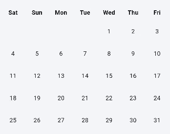
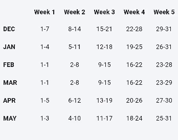

# 📆 m_calendar

A customizable and lightweight Flutter calendar widget package for list-based day selections with user-defined decorations.

---

## 🖼️ Previews

<p float="left">
  
  
  
</p>

---

## ✨ Features

- 📅 **Month View** – Display any month in a responsive calendar layout.
- ✅ **Marked Days** – Highlight days using a simple list.
- 🎨 **Custom Decorations** – Style each cell using `BoxDecoration`.
- 🔥 **User Selection** – Customize picked day styles and icons.
- 📆 **Selection Modes** – Supports both single and range selections.
- 💼 **State Management** – Powered by [`provider`](https://pub.dev/packages/provider).
- 🧩 **Easy Integration** – Embeddable in any UI and layout.

---
## Monthly Calendar
```dart
MCalendar(
    selectedMonth: DateTime.now(),
    onUserPicked: (value) {
    debugPrint('User Get: $value');
    },
),
```

## Weekly Calendar View
```dart
MCalendar.weekly(
    startDay: Day.sunday,
    isRangeSelection: false,
    selectedMonth: DateTime.now(),
    onUserPicked: (value) {
    debugPrint('User Get: $value');
    },
),
```
---
## 🚀 Getting Started

### 1️⃣ Add Dependency

Add this to your `pubspec.yaml`:

```yaml
dependencies:
  m_calendar: ^1.2.1
